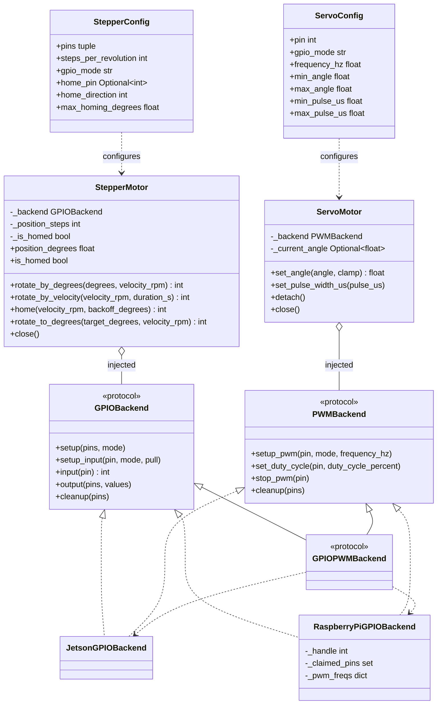
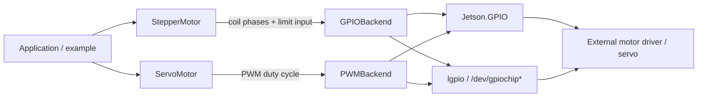

# Actuators Module

The `nectar.actuators` module provides synchronous, open-loop control for GPIO
actuators without requiring ROS 2. Stepper and servo behavior is separated from
the board-specific GPIO implementation through injectable protocols. The same
motor code can run with Jetson.GPIO, Raspberry Pi `lgpio`, or a custom/mock
backend.

## Architecture



`GPIOBackend` and `PWMBackend` are structural protocols: a backend only needs
to implement their methods; it does not need to inherit from them.
`get_default_gpio_backend()` chooses a Jetson or Raspberry Pi implementation
when no backend is supplied. Pass a backend explicitly to override detection or
to use a test double.

## Data flow



The motor methods run synchronously in the calling thread. They return after
the requested steps or duration have been issued; neither driver measures
physical position or confirms that the mechanism reached its target.

## Platform backend selection

By default, the module reads `/proc/device-tree/model` and selects
`JetsonGPIOBackend` for Jetson or `RaspberryPiGPIOBackend` for Raspberry Pi.
When device-tree model information is unavailable, it checks for the
`Jetson.GPIO` and `lgpio` modules. If no backend is detected, construction
raises `RuntimeError`; inject a custom backend on other platforms.

### Jetson

`JetsonGPIOBackend` lazily imports `Jetson.GPIO` when constructed and forwards
the configured `BOARD` or `BCM` pin mode to that library.

### Raspberry Pi

`RaspberryPiGPIOBackend` lazily imports `lgpio`, which uses BCM GPIO numbering
through Linux GPIO chips. With `chip=None`, it tries `gpiochip4` first (Pi 5),
then `gpiochip0` (Pi 3, Pi 4, and Zero 2 W). Set `chip` explicitly to select a
specific chip.

The backend translates the standard 40-pin Raspberry Pi header's GPIO positions
when `gpio_mode="BOARD"`:

| BOARD | BCM | BOARD | BCM | BOARD | BCM | BOARD | BCM |
|------:|----:|------:|----:|------:|----:|------:|----:|
| 3 | 2 | 5 | 3 | 7 | 4 | 8 | 14 |
| 10 | 15 | 11 | 17 | 12 | 18 | 13 | 27 |
| 15 | 22 | 16 | 23 | 18 | 24 | 19 | 10 |
| 21 | 9 | 22 | 25 | 23 | 11 | 24 | 8 |
| 26 | 7 | 27 | 0 | 28 | 1 | 29 | 5 |
| 31 | 6 | 32 | 12 | 33 | 13 | 35 | 19 |
| 36 | 16 | 37 | 26 | 38 | 20 | 40 | 21 |

Power and ground header positions are not GPIOs and are rejected. In `"BCM"`
mode, pin numbers pass through unchanged. A backend instance uses one numbering
mode; do not mix `BOARD` and `BCM` configs on the same backend instance.

Install the board-specific library using the platform's supported package
manager. On Raspberry Pi OS, for example:

```bash
sudo apt install python3-lgpio
```

Ensure the Python environment running Nectar can import the system-installed
module. `Jetson.GPIO` and `lgpio` are optional hardware dependencies; they are
not imported when using an injected backend.

## Stepper motor

`StepperMotor` drives a four-coil stepper with an eight-phase half-step
sequence. `StepperConfig` is a frozen configuration dataclass; its default
pins and sequence match the common four-input driver wiring shown below.

```python
from nectar.actuators import StepperConfig, StepperMotor

config = StepperConfig(
    pins=(11, 13, 15, 16),
    gpio_mode="BOARD",
    steps_per_revolution=4096,
)

with StepperMotor(config) as motor:
    steps = motor.rotate_by_degrees(90, velocity_rpm=1.0)
    print(f"Issued {steps} half-steps")
    motor.rotate_by_velocity(-1.0, duration_s=2.0)
```

`steps_per_revolution` is the number of half-steps at the output shaft for one
revolution. Set it for the motor, gearbox, and driver combination; it is not
automatically detected.

### Stepper configuration

| Field | Default | Description |
|-------|---------|-------------|
| `pins` | `(11, 13, 15, 16)` | Coil-driver input pins, ordered to match the phase sequence |
| `steps_per_revolution` | `4096` | Output-shaft half-steps per revolution |
| `gpio_mode` | `"BOARD"` | Pin numbering mode: `"BOARD"` or `"BCM"` |
| `sequence` | Eight-phase half-step sequence | Per-pin output values for each phase |
| `home_pin` | `None` | Optional limit-switch input, separate from the coil pins |
| `home_active_state` | `0` | Input level that means the switch is active |
| `home_pull` | `"UP"` | Limit input pull: `"UP"`, `"DOWN"`, or `None` |
| `home_direction` | `-1` | Direction to seek the switch: `-1` or `1` |
| `max_homing_degrees` | `360.0` | Maximum travel for each switch-seeking stage |

The four pins must be unique, and every phase in a custom sequence must have
one `0` or `1` value per pin.

### Movement API

- `rotate_by_degrees(degrees, velocity_rpm=1.0)` rotates by a relative angle.
  Positive and negative angles select direction; RPM must be positive.
- `rotate_by_velocity(velocity_rpm, duration_s)` rotates at signed RPM for a
  finite duration. Positive RPM moves forward; negative RPM reverses.
- Both methods return the number of half-steps issued. Small requested
  movements can round to zero steps.
- `position_degrees` is the estimated position based on issued steps. It is not
  encoder feedback and may drift if steps are missed or the motor is moved
  manually.

### Limit-switch homing

Set `home_pin` to enable the bounded three-stage homing operation:

1. Seek the active switch in `home_direction`.
2. Move in reverse until the switch releases, then move the requested
   `backoff_degrees` for clearance.
3. Approach the switch again at one quarter of `velocity_rpm` to latch the
   reference position.

Each switch-seeking stage is limited by `max_homing_degrees`. On success,
`position_degrees` is reset to zero and `is_homed` becomes `True`.
`rotate_to_degrees(target_degrees, velocity_rpm=1.0)` uses that reference and
raises `RuntimeError` if called before successful homing. A missing switch,
failed release, or unsuccessful latch raises `HomingError`. Coils are
de-energized when homing exits, including on failure.

```python
config = StepperConfig(
    pins=(11, 13, 15, 16),
    home_pin=18,
    home_active_state=0,  # active-low switch with pull-up
    home_pull="UP",
    home_direction=-1,
    max_homing_degrees=360,
    steps_per_revolution=4096,
)

with StepperMotor(config) as motor:
    motor.home(velocity_rpm=2.0, backoff_degrees=5.0)
    motor.rotate_to_degrees(90, velocity_rpm=1.0)
```

## Servo motor

`ServoMotor` maps an angle linearly to a pulse width and then to a PWM duty
cycle. `ServoConfig` defaults to 50 Hz, 0-180 degrees, and 500-2500
microseconds. Check the servo's data sheet and adjust the pulse endpoints
before powering it; those defaults are not safe for every servo.

```python
from nectar.actuators import ServoConfig, ServoMotor

config = ServoConfig(
    pin=32,
    gpio_mode="BOARD",
    min_pulse_us=600,
    max_pulse_us=2400,
    initial_angle=90,
)

with ServoMotor(config) as servo:
    servo.set_angle(45)
    servo.set_angle(190, clamp=True)  # commands the configured maximum angle
    servo.detach()  # set duty cycle to zero without releasing the PWM pin
```

### Servo configuration and methods

| Field | Default | Description |
|-------|---------|-------------|
| `pin` | `32` | PWM output pin |
| `gpio_mode` | `"BOARD"` | Pin numbering mode: `"BOARD"` or `"BCM"` |
| `frequency_hz` | `50.0` | PWM frequency |
| `min_angle` / `max_angle` | `0.0` / `180.0` | Configured angle range |
| `min_pulse_us` / `max_pulse_us` | `500.0` / `2500.0` | Pulse endpoints; must be below the PWM period |
| `initial_angle` | `None` | Optional angle commanded during construction |

- `set_angle(angle, clamp=False)` commands an angle and returns the commanded
  value. Out-of-range values raise `ValueError` unless `clamp=True`.
- `set_pulse_width_us(pulse_us)` directly commands a pulse within the configured
  pulse endpoints. It sets `current_angle` to `None`, since a direct pulse is
  not necessarily an angle command.
- `detach()` sends zero duty cycle but leaves the PWM channel configured.
- `close()` stops PWM and releases the pin. `current_angle` records the last
  angle command; the servo does not report its measured shaft position.

## Resource lifecycle and errors

Both motor classes are context managers. Prefer `with` so outputs are released
even if the body raises an exception:

```python
with StepperMotor(config) as motor:
    motor.rotate_by_degrees(45)

with ServoMotor(servo_config) as servo:
    servo.set_angle(90)
```

`close()` is idempotent. Use-after-close operations raise `RuntimeError`.
Invalid configuration and out-of-range commands raise `ValueError`.
`HomingError` is raised when a stepper cannot complete its limit-switch
sequence. Hardware/library errors are surfaced to the caller.

## Examples

Runnable scripts with CLI flags and bench-safety notes:

- [Stepper and servo examples](../examples/actuators/README.md)
- [`stepper_example.py`](../examples/actuators/stepper_example.py)
- [`servo_example.py`](../examples/actuators/servo_example.py)

Run them from the repository root, for example:

```bash
python3 nectar/nectar/examples/actuators/stepper_example.py --degrees 90 --rpm 1
python3 nectar/nectar/examples/actuators/servo_example.py --angles 45 90 135
```

## Safety and limitations

- Do not connect stepper coils or a servo's power lead directly to Jetson or
  Raspberry Pi GPIO pins. Use a motor driver and a suitably rated external
  supply; share ground where required by the driver.
- Confirm pin numbering against the exact board. `BOARD` means physical header
  numbering for the selected platform; the same number is not guaranteed to
  represent the same GPIO signal across different boards.
- Test direction, limit-switch polarity, and mechanical travel at low speed
  before running unattended. A misconfigured homing direction can drive into a
  hard stop.
- Movement is open-loop and synchronous. There is no encoder feedback,
  acceleration ramp, background motion thread, or automatic stall detection.
- Python scheduling, GPIO backend timing, load, power, and mechanical friction
  affect actual motion. Do not treat requested degrees or RPM as a safety-rated
  position or speed guarantee.
- Servo angles and pulse widths are commands only. Verify the supported range
  for the specific servo and mechanism.

## Troubleshooting

- **No default backend found** — install `Jetson.GPIO` or `lgpio`, confirm
  `/proc/device-tree/model`, or pass an explicit backend.
- **Cannot open a GPIO chip on Raspberry Pi** — check that `/dev/gpiochip*`
  exists and that the running user has permission to access it; pass `chip=`
  if your board uses a different chip index.
- **Raspberry Pi reports an invalid BOARD pin** — only GPIO positions in the
  standard 40-pin header are mapped; power and ground positions are rejected.
  Check whether your configuration uses `BOARD` or `BCM`.
- **Stepper vibrates but does not turn** — verify the coil order, driver wiring,
  current limit, motor supply, and `steps_per_revolution`.
- **Homing times out or fails to latch** — check switch wiring and active
  polarity, then verify `home_direction`, `home_pull`, and
  `max_homing_degrees` before increasing travel limits.
- **Servo jitters or stalls** — verify the external supply and common ground,
  lower the mechanical load, and confirm the pulse endpoints and PWM pin.

## Validation

The actuator tests use mock GPIO/PWM backends and do not require a board:

```bash
PYTHONPATH=nectar pytest -q \
    nectar/test/functional/test_actuators.py \
    nectar/test/functional/test_raspberry_gpio.py
```

Hardware movement should first be tested on a bench with the mechanism clear
and within reach of a power disconnect.
